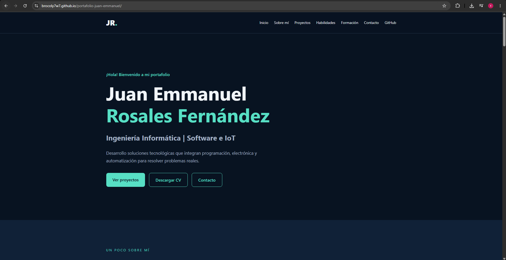

# Portafolio Profesional - Juan Emmanuel Rosales Fernández

Portafolio web profesional de Juan Emmanuel Rosales Fernández,
estudiante de Ingeniería Informática en el Instituto Tecnológico
Superior de Irapuato (ITESI).

## Sitio web

[Visitar portafolio](https://brocoly7w7.github.io/portafolio-juan-emmanuel/)

## Objetivo

Presentar mi perfil profesional, habilidades técnicas,
formación académica y proyectos desarrollados en las
áreas de software, electrónica, IoT y automatización.

## Tecnologías del sitio

- HTML5
- CSS3
- JavaScript
- Git y GitHub
- GitHub Pages

## Proyectos destacados

### 1. KiwPOS
Aplicación móvil desarrollada con Flutter y Dart
para gestionar productos, ventas y tickets.
Utiliza Firebase Cloud Firestore para usuarios y membresías.

### 2. SITE MONITOR
Sistema IoT con ESP32-S3 para monitoreo ambiental,
alertas de Telegram, gráficas y configuración web.

### 3. HydroHero
Videojuego educativo desarrollado con Python y Pygame
para fomentar el cuidado del agua.
Obtuvo el tercer lugar en Track Talents:
evaluación en 2025 y premiación en mayo de 2026.

### 4. Carro Arduino
Automóvil electrónico controlado mediante un mando
de PlayStation 5 y aplicación móvil, con luces LED.

### 5. Dron FPV
Proyecto de ensamblaje e integración de componentes
electrónicos para construir un dron FPV funcional.

## Captura del portafolio

## Estructura del proyecto

- index.html: estructura principal.
- css/: estilos y diseño responsivo.
- js/: interacciones y validación.
- assets/images/: fotografías y capturas.
- docs/: currículum en PDF.
- README.md: documentación.

## Ejecución local

1. Descargar o clonar el repositorio.
2. Abrir la carpeta en Visual Studio Code.
3. Abrir index.html en un navegador web.

## Autor

Juan Emmanuel Rosales Fernández

Ingeniería Informática - ITESI

GitHub: https://github.com/Brocoly7w7
